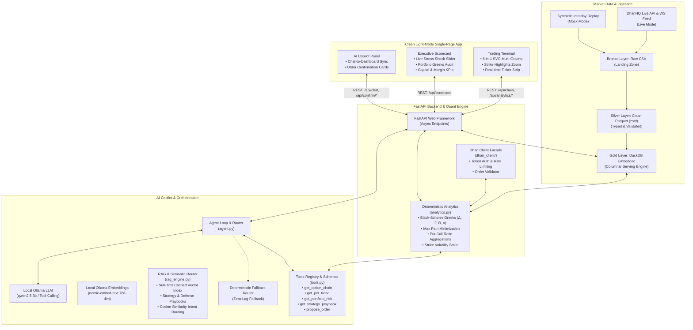
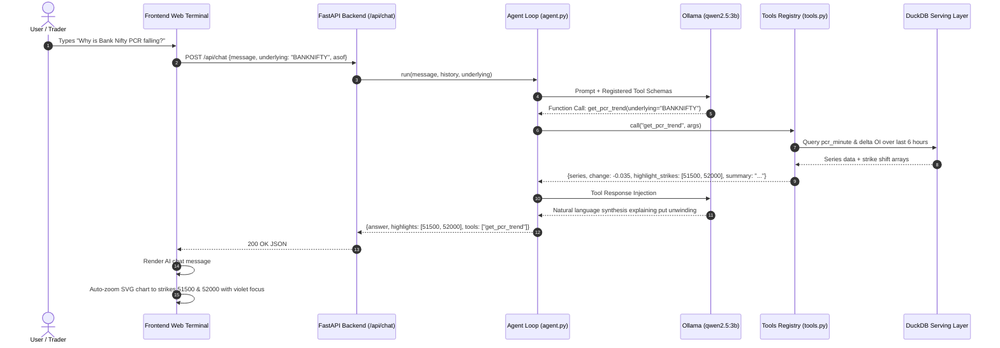
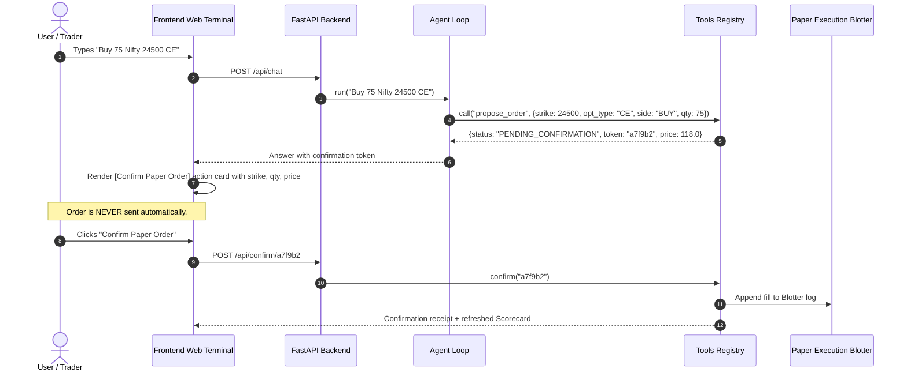

# DhanLens AI — System Architecture & Technical Specifications

This document outlines the end-to-end technical architecture, data pipeline, quantitative modeling, and component communication protocols of **DhanLens AI**.

---

## 1. High-Level Architecture Overview

DhanLens AI follows a modular, decoupled architecture where **conversational reasoning**, **deterministic quantitative computation**, and **high-throughput data serving** are strictly separated.



---

## 2. Medallion Data Pipeline Architecture

To guarantee sub-5ms query times over hundreds of thousands of market ticks, DhanLens AI implements a 3-tier **Medallion Data Architecture**:

```mermaid
flowchart LR
    subgraph Bronze ["1. Bronze Tier (Raw)"]
        B1["chain_raw.csv<br/>(Raw Source Dumps)"]
        B2["candles_raw.csv<br/>(Raw Index Bars)"]
        B3["positions_raw.csv<br/>(Raw Portfolio Snapshot)"]
    end

    subgraph Silver ["2. Silver Tier (Cleaned)"]
        S1["chain.parquet<br/>(zstd compressed)"]
        S2["candles.parquet<br/>(zstd compressed)"]
        S3["positions.parquet<br/>(Typed & Deduplicated)"]
    end

    subgraph Gold ["3. Gold Tier (DuckDB Serving)"]
        G1["chain table<br/>(307,500+ Rows)"]
        G2["candles table<br/>(Indexed Intraday OHLC)"]
        G3["positions table<br/>(Active Multi-Legs)"]
        G4["pcr_minute table<br/>(Pre-aggregated PCR & Spot)"]
    end

    Bronze -->|Deduplication, Row-Number Partitioning, Schema Typing| Silver
    Silver -->|In-Memory Columnar Ingestion & Aggregated Materialization| Gold
```



### Detailed Pipeline Stages:
1. **Bronze (Raw Landing Zone)**:
   - Stores raw tick logs and option snapshots straight from the DhanHQ WebSocket / simulation feed.
   - Preserves complete data lineage without discarding anomalous or out-of-sequence rows.
2. **Silver (Validated Parquet Layer)**:
   - Enforces strict data types: timestamps cast to microsecond precision, prices to `DOUBLE`, volumes and open interest to `BIGINT`.
   - Filters out corrupt records (`oi > 0`, `ltp >= 0`, `iv > 0`, `opt_type IN ('CE', 'PE')`).
   - Deduplicates multiple ticks for the same `(ts, underlying, strike, opt_type)` partition via `row_number()`.
   - Compresses data using `zstd` for compact footprint and rapid disk I/O.
3. **Gold (Serving Layer in DuckDB)**:
   - Single embedded database file (`data/gold/dhanlens.duckdb`).
   - Materializes the `pcr_minute` table pre-aggregating total Call OI, total Put OI, Put-Call Ratio, and Index Spot per minute.
   - Supports parallel vectorized SQL queries executed in < 3ms.

---

## 3. Quantitative Analytics & Greeks Engine (`analytics.py`)

The analytics engine is strictly separated from LLM generation. All numeric calculations are performed in deterministic Python using vectorized NumPy and standard financial algorithms:

### 1. Black-Scholes Option Pricing & Greeks
Given Spot price $S$, Strike $K$, Time to Expiry $T$ (years), Risk-free rate $r = 6.5\%$, and Implied Volatility $\sigma$:

$$d_1 = \frac{\ln(S / K) + \left(r + \frac{\sigma^2}{2}\right) T}{\sigma \sqrt{T}}, \quad d_2 = d_1 - \sigma \sqrt{T}$$

- **Call Price ($C$) & Put Price ($P$)**:
  $$C = S \cdot N(d_1) - K e^{-r T} N(d_2), \quad P = K e^{-r T} N(-d_2) - S \cdot N(-d_1)$$
- **Delta ($\Delta$)**:
  $$\Delta_{\text{Call}} = N(d_1), \quad \Delta_{\text{Put}} = N(d_1) - 1$$
- **Gamma ($\Gamma$)**:
  $$\Gamma = \frac{N'(d_1)}{S \cdot \sigma \sqrt{T}}$$
- **Vega ($\nu$)**: Sensitivity to a $1\%$ change in volatility:
  $$\nu = \frac{S \cdot N'(d_1) \sqrt{T}}{100}$$
- **Theta ($\Theta$)**: Daily time decay collected by option sellers:
  $$\Theta_{\text{Call}} = \frac{-\frac{S \cdot N'(d_1) \cdot \sigma}{2\sqrt{T}} - r K e^{-r T} N(d_2)}{365}$$
  $$\Theta_{\text{Put}} = \frac{-\frac{S \cdot N'(d_1) \cdot \sigma}{2\sqrt{T}} + r K e^{-r T} N(-d_2)}{365}$$

### 2. Max Pain Minimization
Calculates cumulative monetary loss to option buyers across all strikes $k \in \mathcal{K}$:

$$\text{Loss}(k) = \sum_{j} \text{OI}_{\text{CE}}(j) \cdot \max(0, k - j) + \sum_{j} \text{OI}_{\text{PE}}(j) \cdot \max(0, j - k)$$

$$\text{Max Pain Strike} = \arg\min_{k} \left( \text{Loss}(k) \right)$$

### 3. Put-Call Ratio (PCR)
$$\text{PCR} = \frac{\sum \text{Put Open Interest}}{\sum \text{Call Open Interest}}$$

---

## 4. Dhan Client Subsystem (`backend/dhan_client/`)

The Dhan client is architected as an extensible facade supporting both live broker connectivity and offline quantitative replay:

```
dhan_client/
├── __init__.py       # DhanClient façade & get_client() factory
├── config.py         # DhanConfig dataclass, rate limits, segment constants
├── exceptions.py     # Hierarchical exceptions (Auth, RateLimit, Network, Validation)
├── models.py         # Strictly typed Pydantic models (Tick, OptionChainSnapshot, Position)
├── mock_client.py    # Time-travel simulation engine with scrubber & replay controls
├── rest_client.py    # DhanHQ REST v2 client with automatic exponential retries
└── websocket_feed.py # Real-time Quote/Ticker packet decoder
```

- **Factory Pattern (`get_client()`)**: Inspects `DHAN_MODE` in environment variables. If `live`, instantiates authenticated HTTP/WS handlers; if `mock`, instantiates the simulation engine.
- **Segment Encoding**: Maps internal index names to Dhan's exchange constants:
  - `NIFTY` $\rightarrow$ Security ID `13`, Segment `IDX_I`, F&O Segment `NSE_FNO`
  - `BANKNIFTY` $\rightarrow$ Security ID `25`, Segment `IDX_I`, F&O Segment `NSE_FNO`

---

## 5. End-to-End Sequence Workflows

### Sequence A: Conversational AI Query & Visual Sync


### Sequence B: Supervised Order Execution Guardrail


---

## 6. Security, Safety & Operational Guardrails

1. **Read-Only Database Locking**: DuckDB is initialized with `read_only=True` in serving processes, ensuring analytical reads can never corrupt raw data.
2. **Order Execution Barrier**: The AI has access only to `propose_order`, which generates an in-memory staging token. The physical order dispatch endpoint requires deliberate human action.
3. **Graceful Degraded Mode**: If local Ollama is offline or uninstalled, the agent automatically falls back to the internal deterministic router in < 1.5 seconds, guaranteeing zero downtime during demos or live trading.
4. **Rate Limiting**: Sliding window rate limiter restricts chat questions to 20 queries/minute to prevent resource exhaustion.
