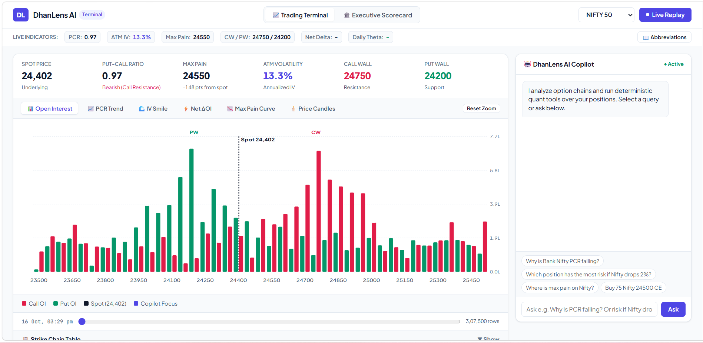

# DhanLens AI — Intelligent Derivatives Terminal & Executive Scorecard

> **Ask your option chain in plain English. The AI explains, deterministic quant tools calculate, and the visual chart auto-zooms to the strikes that matter.**

DhanLens AI is an institutional-grade derivative intelligence terminal and visual copilot built for the Indian options ecosystem (**NIFTY & BANK NIFTY**). It bridges conversational AI and real-time execution, giving retail F&O traders and quantitative desks an interactive edge on expiry days.

---

## 🌟 Key Features & Use Cases

### 1. Live Interactive Derivative Terminal
- **6-in-1 Quantitative Multi-Graphs**: Switch seamlessly between **Open Interest Distribution**, **PCR & Spot Intraday Trend**, **IV Smile & Skew Curve**, **Net $\Delta$OI Shift**, **Max Pain Payoff**, and **15-Min Price Candles**.
- **Real-Time Abbreviation Ticker**: Instant live badges for Put-Call Ratio (**PCR**), At-The-Money Implied Volatility (**ATM IV**), Max Pain (**MP**), Call/Put Walls (**CW/PW**), Portfolio Net Delta, and Daily Theta income.
- **Collapsible Strike Inspector**: Full tabular option chain inspector with strike-by-strike Call/Put volume, IV, LTP, and OI.

### 2. Bidirectional "Chat-to-Dashboard" Sync
- Traditional chatbots output detached walls of text. DhanLens AI features **active visual synchronization**: when you ask *"Why is Bank Nifty PCR falling?"*, the copilot explains the institutional put unwinding in text and **auto-zooms the chart to highlight the exact driving strikes**.

### 3. Executive Business Scorecard & Live Stress Testing
- Switch to the **Executive Scorecard** tab for a high-level view of capital and risk:
  - **Portfolio Health Score & Net Greeks**: Real-time aggregation of Net Delta ($\Delta$), Gamma ($\Gamma$), Vega ($\nu$), and daily time-decay earnings ($\Theta$ in ₹/day).
  - **Market Shock Simulator**: Drag an interactive spot-shock slider from **$-5\%$ (Crash)** to **$+5\%$ (Rally)** to reprice all open positions via Black-Scholes and preview exact rupee P&L impacts.
  - **Risk Guardrails & Audit Blotter**: Active checks on delta neutrality, daily stop-loss ceiling, margin cushion, and paper order history.

### 4. Deterministic Reliability & Strategy Playbook RAG
- The LLM **never calculates numbers or guesses option pricing**. It coordinates through verified quantitative tools (`Black-Scholes`, `DuckDB SQL`, `max_pain`, `pcr_trend`, `oi_change`) over local columnar data.
- **RAG & Semantic Intent Engine (`nomic-embed-text`)**: Powered by your local Ollama embeddings, the copilot features sub-millisecond semantic tool routing and institutional **Option Strategy & Defense Playbooks** (`get_strategy_playbook`), guiding traders through live adjustments for Iron Condors, Strangles, Skew hedging, and Gamma squeeze protection.

---

## 📸 Screenshots & Visual Walkthrough

Here is a visual walkthrough of DhanLens AI in action (assets located in the [`images/`](images/) directory):

### 1. The Clean Light-Mode Terminal

*The default Trading Terminal view featuring the live metric strip, KPI cards (Spot, PCR, Max Pain, ATM IV, Call Wall, Put Wall), the 6-in-1 multi-graph viewport, and the AI Copilot on the right.*

---

### 2. Live Market Replay & Scrubber

*Clicking "Live Replay" starts minute-by-minute replay of intraday option chain data. The timeline scrubber lets traders pause, rewind, or jump to specific market hours.*

---

### 3. Visual Sync: "Why is Bank Nifty PCR falling?"

*When asking why PCR is declining, the copilot executes `get_pcr_trend`, identifies institutional put unwinding, and automatically highlights the key driver strikes directly on the chart.*

---

### 4. Risk Simulation: "Which position has the most risk if Nifty drops 2%?"

*The copilot runs `get_portfolio_risk`, applies Black-Scholes spot revaluation across all open legs, reports the net ₹ P&L impact, and highlights the single riskiest strike.*

---

### 5. Supervised Order Execution: "Buy 75 Nifty 24500 CE"

*Strict execution guardrails in action. The copilot never places orders autonomously; it stages a proposed paper trade card requiring explicit human confirmation.*

---

### 6. Executive Business Scorecard & Stress Testing

*The dedicated Business Scorecard view showing portfolio health, capital utilization, live market shock slider ($-5\%$ to $+5\%$), active legs, and institutional compliance checks.*

---

## 📖 Financial Concepts & Data Definitions

| Concept | Abbreviation | Plain-English Definition & Practical Interpretation |
| :--- | :--- | :--- |
| **NIFTY 50 / BANK NIFTY** | `INDEX` | Flagship benchmark equity indices of the National Stock Exchange of India (NSE). Highly liquid underlying assets for index derivatives. |
| **Option Chain** | `CHAIN` | The complete matrix of all listed Call (`CE`) and Put (`PE`) option contracts across multiple strike prices for an upcoming expiry date. |
| **Call Option** | `CE` | A derivative contract giving the buyer the right (not obligation) to buy the underlying. High Call OI represents overhead resistance (sellers cap price). |
| **Put Option** | `PE` | A derivative contract giving the buyer the right to sell the underlying. High Put OI represents support floors (sellers absorb downside). |
| **Strike Price** | `K` | The predetermined price at which the derivative contract can be exercised upon expiry. |
| **Last Traded Price** | `LTP` | The most recent execution price of the option contract in the market. |
| **Open Interest** | `OI` | The total number of open, unsettled active contracts held by market participants. Tracking changes in OI ($\Delta$OI) reveals institutional smart money positioning. |
| **Put-Call Ratio** | `PCR` | Computed as $\frac{\sum \text{Put OI}}{\sum \text{Call OI}}$. A PCR $> 1.0$ signals strong put writing and a bullish floor; a PCR $< 0.8$ signals aggressive call writing and bearish overhead pressure. |
| **Max Pain** | `MP` | The strike price where option buyers as a whole experience the greatest financial loss upon expiry. Market makers tend to pin the spot near this strike. |
| **Implied Volatility** | `IV` | The market's expectation of future price swings priced into option premiums. Higher IV widens expected moves and elevates option prices. |
| **At-The-Money** | `ATM` | The strike price closest to the current spot price of the index. Options deeper in the money are `ITM`; options out of the money are `OTM`. |
| **Delta** | $\Delta$ | Sensitivity of option price to a ₹1 move in spot. Calls have positive delta ($0$ to $+1$), Puts have negative delta ($-1$ to $0$). |
| **Gamma** | $\Gamma$ | Rate of change of Delta per ₹1 move in spot (directional acceleration). High near ATM on expiry day. |
| **Theta** | $\Theta$ | Daily rate of time-decay loss on an option contract. For net option sellers, Theta is positive daily income earned. |
| **Vega** | $\nu$ | Sensitivity of option price to a $1\%$ change in Implied Volatility. |
| **Mark-to-Market P&L** | `MTM` | Real-time valuation of open positions: $(\text{LTP} - \text{Avg Price}) \times \text{Quantity}$. |
| **Call Wall / Put Wall** | `CW / PW` | The single strike holding the largest Call OI (overhead resistance ceiling) and Put OI (support floor). |

---

## 📊 Data Summary & Column Specifications

DhanLens AI organizes all market data into an embedded, high-performance DuckDB columnar serving layer (`data/gold/dhanlens.duckdb`) containing over **307,500 rows** of processed tick data:

### 1. `chain` Table (Full Option Chain Snapshots)
Contains minute-by-minute strike snapshots for NIFTY and BANK NIFTY:
- `ts` *(TIMESTAMP)*: Exact timestamp of the option chain snapshot.
- `trade_date` *(DATE)*: Calendar date of trading session.
- `underlying` *(VARCHAR)*: Index name (`NIFTY` or `BANKNIFTY`).
- `strike` *(INTEGER)*: Option strike price (e.g., `24500`, `51500`).
- `opt_type` *(VARCHAR)*: Option type: `CE` (Call) or `PE` (Put).
- `ltp` *(DOUBLE)*: Last traded premium price in INR.
- `iv` *(DOUBLE)*: Annualized Implied Volatility (e.g., `0.142` for $14.2\%$).
- `oi` *(BIGINT)*: Total open interest contracts active at this strike.
- `volume` *(BIGINT)*: Cumulative intraday contracts traded.
- `spot` *(DOUBLE)*: Underlying index spot price at that timestamp.

### 2. `candles` Table (Intraday Index Price Action)
Indexed 1-minute OHLC bars used for charting and trend evaluation:
- `ts` *(TIMESTAMP)*: Candle start time.
- `underlying` *(VARCHAR)*: Index symbol.
- `open`, `high`, `low`, `close` *(DOUBLE)*: Bar prices.
- `volume` *(BIGINT)*: Total shares/contracts transacted during the bar.

### 3. `positions` Table (Active Portfolio Legs)
Real-time snapshot of the trader's hedged options portfolio:
- `underlying` *(VARCHAR)*: `NIFTY` or `BANKNIFTY`.
- `strike` *(INTEGER)*: Strike price of open position.
- `opt_type` *(VARCHAR)*: `CE` or `PE`.
- `qty` *(BIGINT)*: Net quantity (positive = long/buyer, negative = short/writer).
- `avg_price` *(DOUBLE)*: Volume-weighted entry price.

### 4. `pcr_minute` Table (Pre-Aggregated Gold Serving Table)
Materialized view for sub-millisecond sentiment charting:
- `ts` *(TIMESTAMP)*: Minute timestamp.
- `underlying` *(VARCHAR)*: Index symbol.
- `pe_oi` *(BIGINT)*: Total Put Open Interest across all strikes.
- `ce_oi` *(BIGINT)*: Total Call Open Interest across all strikes.
- `pcr` *(DOUBLE)*: Ratio: `pe_oi / ce_oi`.
- `spot` *(DOUBLE)*: Index spot level.

---


### Switching to Live DhanHQ Mode
To connect to live Dhan market data, copy `.env.example` to `.env` and provide your credentials:
```ini
DHAN_MODE=live
DHAN_CLIENT_ID=your_dhan_client_id
DHAN_ACCESS_TOKEN=your_dhan_access_token
```

## 🏛️ Additional Documentation

- **[BUSINESS.md](BUSINESS.md)**: Business perspective, target personas, ROI, and commercial integration with the Dhan ecosystem.
- **[ARCHITECTURE.md](ARCHITECTURE.md)**: Technical architecture, Medallion data pipeline, quantitative equations, and sequence diagrams.
